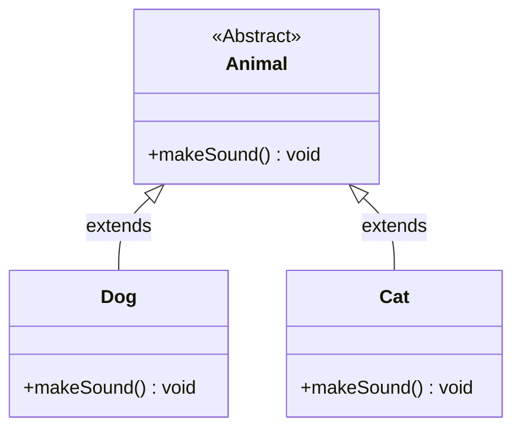

# Object-Oriented Programming: Polymorphism

> "One name, many forms."

## 📌 Table of Contents

1. [What is Polymorphism?](#what-is-polymorphism)
2. [Real-World Analogy](#real-world-analogy)
3. [Types of Polymorphism](#types-of-polymorphism)
   - [Compile-Time (Static) Polymorphism](#1-compile-time-static-polymorphism)
   - [Runtime (Dynamic) Polymorphism](#2-runtime-dynamic-polymorphism)
4. [Compile-Time vs. Runtime Polymorphism](#compile-time-vs-runtime-polymorphism)
5. [UML Architecture](#uml-architecture)
6. [Code Implementation (Java)](#code-implementation-java)
7. [Why Polymorphism Matters in Design Patterns](#why-polymorphism-matters-in-design-patterns)
8. [Common Interview Questions & Easy-Word Answers](#common-interview-questions--easy-word-answers)
9. [Quick Practice Exercise](#quick-practice-exercise)

---

## 1. What is Polymorphism?

The word **Polymorphism** is derived from two Greek words:
* **Poly:** Many
* **Morph:** Form / Shape

In Object-Oriented Programming, **polymorphism** is the ability of an entity (such as a variable, function, or object) to take on multiple forms. It allows a single interface or parent reference to execute different underlying logic depending on the object invoking it.

---

## 2. Real-World Analogy

### The Person Analogy 👤
Consider a single human being:
* At home, they act as a **parent** or **child**.
* In an office, they act as an **employee**.
* In a store, they act as a **customer**.
* In a vehicle, they act as a **driver**.

The person is the exact same individual, but their behavior and role change depending on the context.

### The USB Port Analogy 🔌
A standard USB port can accept a **mouse**, a **keyboard**, an **external hard drive**, or a **microphone**. The computer communicates via the universal USB interface, but each connected hardware device behaves completely differently when invoked.

---

## 3. Types of Polymorphism

```
                    Polymorphism
                         │
         ┌───────────────┴───────────────┐
         ▼                               ▼
    Compile-Time                      Runtime
   (Static Binding)              (Dynamic Binding)
         │                               │
         ▼                               ▼
  Method Overloading             Method Overriding
```

### 1. Compile-Time (Static) Polymorphism
* **Mechanism:** Method Overloading.
* **Resolution:** Decided by the compiler during compilation based on the method name, parameter count, or parameter types.
* **Binding:** Early / Static Binding.

### 2. Runtime (Dynamic) Polymorphism
* **Mechanism:** Method Overriding (Dynamic Method Dispatch).
* **Resolution:** Decided at runtime by the Virtual Machine (JVM/CLR) based on the actual object instance stored in memory, not the reference type.
* **Binding:** Late / Dynamic Binding.

---

## 4. Compile-Time vs. Runtime Polymorphism

| Feature | Compile-Time Polymorphism | Runtime Polymorphism |
| :--- | :--- | :--- |
| **Achieved By** | Method Overloading | Method Overriding |
| **Execution Time** | Resolved at compile time | Resolved at execution / runtime |
| **Inheritance Needed?** | No (occurs within the same class) | Yes (requires inheritance or interface implementation) |
| **Method Signature** | Must differ in parameters (type, count, or order) | Must match exactly (name, parameters, return type) |
| **Performance** | Faster execution (no runtime lookup overhead) | Slightly slower (requires dynamic dispatch lookup table) |
| **Flexibility** | Moderate | High (key enabler for loose coupling) |

---

## 5. UML Architecture

### Dynamic Dispatch Flow

```text
               +-----------------------------+
               |        Animal               |
               +-----------------------------+
               | +makeSound(): void          |
               +-----------------------------+
                              ^
                              |
               +--------------+--------------+
       extends |                             | extends
+----------------------+             +----------------------+
|        Dog           |             |        Cat           |
+----------------------+             +----------------------+
| +makeSound(): void   |             | +makeSound(): void   |
| (prints "Woof!")     |             | (prints "Meow!")     |
+----------------------+             +----------------------+
```

### Mermaid Diagram


---

## 6. Code Implementation (Java)

### Part A: Compile-Time Polymorphism (Method Overloading)

```java
public class Calculator {

    // Overloaded method 1: takes 2 integers
    public int add(int a, int b) {
        return a + b;
    }

    // Overloaded method 2: takes 3 integers
    public int add(int a, int b, int c) {
        return a + b + c;
    }

    // Overloaded method 3: takes 2 doubles
    public double add(double a, double b) {
        return a + b;
    }
}
```

### Part B: Runtime Polymorphism (Method Overriding & Dynamic Dispatch)

```java
// 1. Base Class
abstract class Animal {
    public abstract void makeSound();
}

// 2. Subclass A
class Dog extends Animal {
    @Override
    public void makeSound() {
        System.out.println("Dog says: Woof Woof!");
    }
}

// 3. Subclass B
class Cat extends Animal {
    @Override
    public void makeSound() {
        System.out.println("Cat says: Meow!");
    }
}

// 4. Client Code leveraging Polymorphism
public class Main {
    public static void main(String[] args) {
        // Parent class reference holding child class objects
        Animal myDog = new Dog();
        Animal myCat = new Cat();

        // The exact method executed is determined at RUNTIME
        playWithAnimal(myDog); // Output: Dog says: Woof Woof!
        playWithAnimal(myCat); // Output: Cat says: Meow!
    }

    // This method does not need to change when new animals are introduced
    public static void playWithAnimal(Animal animal) {
        animal.makeSound();
    }
}
```

---

## 7. Why Polymorphism Matters in Design Patterns

Polymorphism forms the foundation of design patterns by ensuring systems stay open for extension but closed for modification (the Open/Closed Principle):

1. **Strategy Pattern:** Uses polymorphism to swap algorithm behaviors on the fly through an interchangeable interface reference.
2. **State Pattern:** Changes an object's internal behavior when its state object changes via polymorphic state delegations.
3. **Template Method Pattern:** The parent algorithm defines the skeleton, letting polymorphic subclasses override specific steps.
4. **Command Pattern:** Encapsulates actions into objects invoked through a unified `execute()` polymorphic interface.

---

## 8. Common Interview Questions & Easy-Word Answers

### Q1: What is Polymorphism in simple words?
> **Answer:** Polymorphism means "many forms." It allows a single method name or reference type to produce different behaviors based on the object executing it.

### Q2: What is Dynamic Method Dispatch?
> **Answer:** Dynamic Method Dispatch is the mechanism by which a call to an overridden method is resolved at runtime rather than compile time. The JVM checks which concrete instance exists in memory and runs that object's specific method version.

### Q3: Can you overload a method just by changing its return type?
> **Answer:** No. Changing only the return type produces a compile error. Overloading requires a difference in the method's parameter list (number, type, or order of parameters).

### Q4: Can private, static, or final methods be overridden?
> **Answer:**
> * **`private` methods:** Cannot be overridden because they are not visible to child classes.
> * **`static` methods:** Cannot be overridden; they belong to the class, not instances (re-declaring them is known as method *hiding*).
> * **`final` methods:** Cannot be overridden by rule of the keyword to prevent modification.

### Q5: What is the difference between Upcasting and Downcasting?
> **Answer:**
> * **Upcasting:** Converting a subclass reference to a parent class reference (e.g., `Animal a = new Dog();`). This is safe and happens automatically.
> * **Downcasting:** Converting a parent class reference back to a subclass reference (e.g., `Dog d = (Dog) a;`). This must be done explicitly and requires type checking (`instanceof`) to avoid `ClassCastException`.

---

## 9. Quick Practice Exercise

To test your polymorphic thinking:

- [ ] Create an abstract base class `Vehicle` with an abstract method `startEngine()`.
- [ ] Implement three classes: `Car`, `Motorcycle`, and `ElectricScooter`.
- [ ] Build a method `testDrive(Vehicle vehicle)` that calls `startEngine()` without using `if-else` or `instanceof` checks.
- [ ] Add a new class `Truck` without touching any existing methods to verify Open/Closed compliance.

---

*Part of the [OOP & Design Patterns Roadmap](../README.md)*